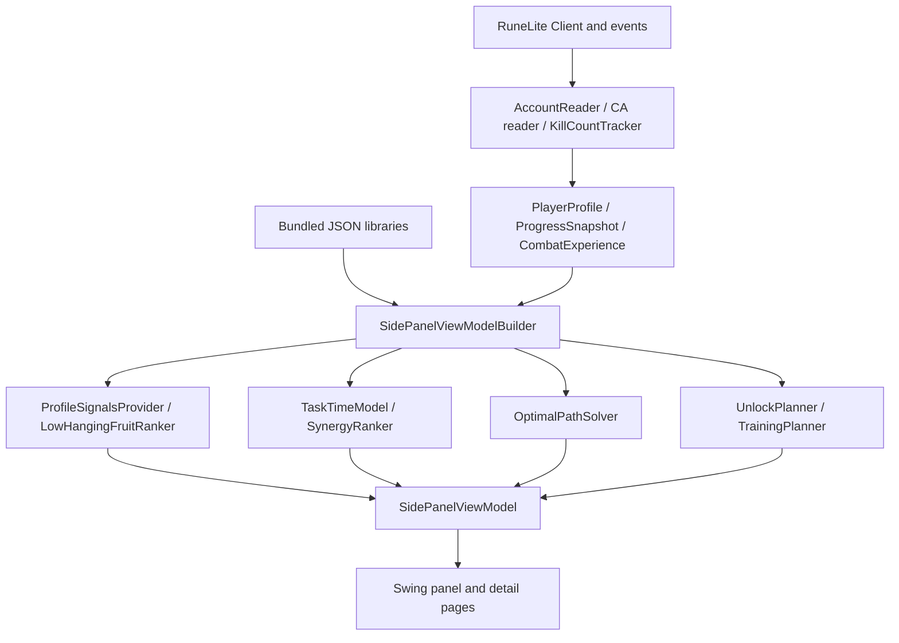

# CA Route: Phase 0 technical audit

Prepared 3 October 2026 before production implementation. This document records the original audit and design proposal; see [current implementation status](MVP_STATUS.md) for subsequent work.

**Recommendation: selectively adapt Combat Achievement Helper's tested foundations, rather than fork its complete runtime or rewrite everything.** Keep its data-loading approach, RuneLite completion bridge, relevant tests, and the two-level knapsack idea. Replace the shared session cost calculation, eligibility representation, account snapshots, and route orchestration. Gear readiness and explainable session costs should be the differentiators.

The audit examined a temporary checkout of **`opaf-osrs/combat-achievement-helper` at `25ebeeb09069ef544f7c10a5219bc1a321b88cf7`**, version 1.3, last commit dated 13 September 2026. The Plugin Hub manifest also points to this revision. Findings below concern this snapshot, not an assurance that its bundled metadata matches the live game on 3 October. At audit start, the CA Route workspace contained a README, BSD license, and Git configuration, with no Java project. [Upstream repository][H-ROOT] [Hub manifest][H-HUB]

The upstream build was inspected and its existing tests executed using Java 11 and the checksum-pinned Gradle 8.10 wrapper: **234 tests across 43 suites passed, with zero failures, errors, or skipped tests**. This verifies the existing assertions; it does not validate the timing estimates against gameplay or prove the proposed optimizer correct. `ScenarioDemoTest` also generated `build/scenarios.txt`, which was inspected.

## 1. Existing architecture

The project already has a useful boundary between RuneLite/Swing and pure Java planning logic:



`CombatAchievementsPlugin` loads resources, registers the sidebar, reads account state, handles events, and persists customizations. `AccountReader` maps real skills and quest states into string-keyed `PlayerProfile`. `CombatAchievementVarbitReader`, despite its name, reads task completion from packed **varps**, plus the game's point total. `KillCountTracker` parses kill-count chat and caches progress; `HiscoreKcReader` converts hiscore results into boss KC. [Plugin][H-PLUGIN] [Account reader][H-ACCOUNT] [Completion reader][H-COMPLETE]

The `core` packages contain achievement metadata and libraries; ranking and signals; effort/time/session models; unlock and training planners; tier arithmetic; route plans; and view models. The route solver is independent of RuneLite types. `SidePanelViewModelBuilder` connects most of this logic, which makes it the main orchestration bottleneck. Swing pages already include Recommended, Bosses, Route, boss/task detail, and unlock detail. There is no need to begin with a visual redesign. [Builder][H-BUILDER] [Panel][H-PANEL]

An additional `core/combat` package has DPS formulas, monster statistics, and `SpeedFeasibilityModel`, with tests. Its package documentation explicitly says this planned gear feature is **not wired into the panel**. Existing combat math therefore is not evidence of working equipment or bank awareness. [Combat package][H-COMBAT]

## 2. Files and classes to reuse

“Reuse” below means retain attribution where code is copied, port appropriate tests, and verify each contract against the selected RuneLite release.

| Existing files/classes | Recommendation |
| --- | --- |
| `core/achievement/CombatAchievement`, `AchievementTier`, `CombatAchievementLibrary`, `core/data/BundledJson` | Adapt immutable values and classpath stream loading. Add strict ID, reference, version, and completeness validation. Keep game task types separate from routing tags. |
| `varbit/CaVarbitIds`, `CombatAchievementVarbitReader`, `core/progress/ProgressSnapshot` | Adapt bitfield decoding and game/computed point comparison. Replace raw fallbacks where supported constants exist; add authoritative thresholds and snapshot validity. |
| `bridge/AccountReader`, `KillCountTracker`, `HiscoreKcReader` | Adapt local reads, boss aliases, and tested chat parsing. Replace swallowed read failures with unknown facts. Hiscores must be optional and disabled by default. |
| `core/ranking/PlayerProfile`, `ProfileSignalsProvider`, `SignalsProvider` | Reuse the bridge-to-pure-core pattern and quest/stat tests. Replace Boolean eligibility and string-only identity with typed, three-valued requirements. |
| `core/effort/TaskTimeModel`, `CombatExperience`, `ScalingLibrary`, `BossTimingLibrary` | Adapt attempts, live KC subtraction, competence, and centralized tuning as explicit cost components. Replace description-based repeat inference and implicit fallbacks. |
| `core/effort/SynergyRanker`, `BossSession` | Reuse session grouping and KC milestone concepts. Replace the session evaluator so ranking, optimization, and displayed ETA use one implementation. |
| `core/path/OptimalPathSolver`, `PathPlan`, `PathStep` | Reuse covering/multiple-choice DP structure and regression fixtures. Replace additive boss options and task-centric results with explicit session options and verified reachability. |
| `core/effort/UnlockPlanner`, `TrainingPlanner`, quest/XP libraries | Adapt as separate prerequisite advisers. Do not present their heuristic suggestions as an optimized quest-plus-boss route. |
| `core/ui/SidePanelViewModel` and `ui/pages/*` | Reuse presentation patterns after the domain contracts stabilize. Split computation out of the builder. |
| Tests for libraries, profiles, quests, KC, tier math, path DP, session ranking, readiness, and scenarios | Port assertions that encode valid behavior. Correct assumptions identified in this audit before preserving them. |

Source navigation: [core][H-CORE], [bridge][H-BRIDGE], [tests][H-TESTS]. Data reuse requires a separate licensing decision; see section 12.

## 3. Existing logic already good enough as a foundation

**Task ranking.** `LowHangingFruitRanker` removes completed IDs, optionally filters unmet access/skill gates, and ranks by points per effort with deterministic tie breaking. `EffortModel` exposes gear, RNG, supply, group, learning, and access penalty components. With timing available, task effort uses minutes × square-root difficulty factor × speed-tier factor × recommended-stat sink; its fallback uses the dimensionless effort model and a repeat-count proxy. Completion percentage is not used as a substitute for difficulty. The separate low-level account guard in `SidePanelViewModelBuilder` considers combat level, so an established account with zero CA points is not automatically treated as a beginner. [Ranker][H-RANK] [Effort model][H-EFFORT] [Tuning][H-TUNING] [Builder][H-BUILDER]

**Quest/stat gates.** Quest requirements distinguish started and completed states. Hard requirements remain distinct from soft recommended levels. Unverifiable free-form access hints are advisory, which is preferable to fabricating an impossible gate. However, unreadable live facts currently have a different problem: they become absent values and can cause false locks. [Profile signals][H-SIGNALS] [Quest requirement][H-QUESTREQ]

**Time and KC.** `TaskTimeModel` uses completion duration, downtime, retries, curated difficulty, KC-derived competence, and per-task attempts overrides. It subtracts live KC for KC tasks. `SynergyRanker` groups bosses, charges setup once, and computes incremental nested KC milestones. These are valuable ingredients, subject to the semantic corrections in section 4. [Time model][H-TIME] [Session ranker][H-SYNERGY]

**Route selection.** `solve` implements an exact minimum-cost covering knapsack over points for independent additive tasks. `solveClustered` first creates per-boss point/cost options, then selects at most one option per boss and charges one trip overhead. This already addresses boss switching; the new product must improve its inputs rather than claim this concept is absent. Exactness applies to its declared additive model, not actual gameplay. [Solver][H-SOLVER]

**Prerequisite suggestions.** `UnlockPlanner` considers quest chains and associated training, while `TrainingPlanner` identifies useful level milestones and uses XP-rate data. These can explain what opens better routes without mixing inaccessible tasks into the doable-now plan. [Unlock planner][H-UNLOCK] [Training planner][H-TRAIN]

**Delivery and tests.** Bundled JSON loads through streams, the engine runs without a game client, Swing tests run headlessly, and scenario tools exist. Keep those practices. The developer build's `latest.release` dependency is convenient but is not a reproducible API baseline; record the resolved version in CI. [Build][H-BUILD]

## 4. Components that must change or be replaced

| Finding and evidence | Consequence | Required change |
| --- | --- | --- |
| `OptimalPathSolver.solveClustered`, lines 145–176, sums independent task costs inside a boss; `SynergyRanker`, lines 70–100, separately collapses KC milestones. | The route can charge 25 + 75 + 150 kills while the boss view describes a shared grind toward 150. | A common non-additive session evaluator must generate all solver options and ETAs. |
| `TaskTimeModel.requiredKills`, lines 24–27 and 80–96, parses “kill N”; `estimate`, lines 211–249, applies it to execution tasks as full activity completions. Actual task 525 refers to six Giant Rats inside a Scurrius encounter, and task 228 to three Snakelings. | Add targets can multiply full boss/run time. | Explicit `completionUnit`, `completionCount`, and `kcThreshold`; use wording inference only as a marked low-confidence migration fallback. |
| `SidePanelViewModelBuilder`, lines 471–475, passes `rankedIncomplete` straight to the GM branch. Earlier beginner filtering can remove tasks; non-GM filtering/customization happens later. `solveCompleteAll`, lines 283–299, calls a nonempty set reachable. | GM can omit canonical remaining tasks or include locked/excluded ones while reporting reachability; route details can label locked tasks available. | GM must use the canonical remaining-ID set, preserve every blocker, and test complete-all coverage independently of point totals. |
| Builder lines 493–526 remove pins, reduce the gap by their points, then solve without recording the bosses already used by the pinned bundle. | Setup can be charged again and the optimizer may choose an unnecessary extra stop. | Enforce pins as session constraints and account for their shared work and setup before comparing marginal options. |
| `AccountReader` catches failed reads; `PlayerProfile` treats an absent skill as 0 and absent quest as false. | Unknown client state can become a hard lock. | Known/unknown facts with reasons and snapshot readiness. |
| Plugin refresh listeners cover login, CA varps, KC chat, config and customization, but do not directly cover skill, quest, equipment, or bank changes. | Relevant state may remain stale until another event happens. | A dedicated invalidation coordinator for each relevant state source. |
| Plugin lines 290–297 automatically call `lookupAsync(name, endpoint)` on account initialization. README says nothing is sent anywhere. | A player name is sent to an external hiscores service; the README overstates privacy. | Local-only default; optional disclosed KC import, or omit it in MVP. |
| The async hiscore callback checks account hash, then mutates shared KC state and persists using the current account key. Those operations are not atomic with account switching. | A callback can pass its guard before a switch and subsequently seed/save into another account. | Marshal updates to the client thread, recheck account and generation, and save to the captured account key. |
| `task_effort.json` has 477 rows, but only five contain curated gear/RNG/supply/access/soloability signals; “curated count” counts all rows. | Coverage labels can imply much more readiness knowledge than exists. | Coverage per field, explicit unknown values, and evidence quality. |
| `BundledJson` silently discards malformed optional files/entries, and fallback values are not distinguished from verified data. | Missing or broken metadata can silently change eligibility and recommendations. | Preserve diagnostics and evidence status; use explicit degraded-data results. |
| The route's “quickest” cost multiplies minutes by difficulty and readiness; training and route readiness definitions differ. | Objective labels can imply elapsed-time optimization, and advisers can disagree about what is ready. | Separate physical time from objective cost and share an explicit readiness contract. |
| Upstream `.gitignore` excludes root `data/` and `docs/`. Resources refer to absent CSVs, generators, quest-gate research and design documents. | Metadata cannot be reproduced or audited fully from the public repository. | Check in the curation source, transformation scripts, licenses and validation workflow. |
| `TierMath` derives thresholds from bundled task sums. The completion reader uses live points but still calls that arithmetic. | Live points do not make stale dataset thresholds authoritative. | Read numerical threshold varbits and separate tier-status signals; retain versioned data only as a clearly identified fallback. |

Evidence: [solver][H-SOLVER], [time model][H-TIME], [builder][H-BUILDER], [plugin][H-PLUGIN], [profile][H-PROFILE], [effort data][H-EFFORTDATA], [JSON loaders][H-JSON], [ignore file][H-IGNORE], [tier math][H-TIER].

The passing scenario suite also illustrates why golden assertions matter. Scenario E prints a naive Zulrah KC cost of **500 minutes** and a bundled cost of **450 minutes**. Its naive path omits the per-task attempts overrides, while the bundled path uses overrides of 2, 2, and 1 for the 25/75/150 milestones. The report compares different assumptions, and the shared grind changes its retry factor by milestone. The subtraction algorithm itself sorts thresholds correctly. Establish one encounter-rate model, model any learning progression explicitly, and assert the resulting costs. [Scenario test][H-SCENARIO] [Difficulty data][H-DIFFICULTY]

Additional limitations: no typed `GearProfile`, account-type economics, structured uncertainty/confidence, general task compatibility/dependency graph, or NORMAL/PREFER_NOT/AVOID preference contract. `ProfileSignalsProvider` currently hardcodes `gearOwned=false` and `bossEngaged=false`; a gear penalty is not ownership awareness. The route sorts chosen bosses by their total cost rather than optimizing travel between specific locations. [Profile signals][H-SIGNALS] [Solver][H-SOLVER]

## 5. Proposed repository architecture

Use one Java 11-compatible plugin artifact initially, with package boundaries and tests enforcing a RuneLite-free core. Avoid a multi-module build unless packaging requirements justify it.

```text
src/main/java/<package>/
  plugin/                 lifecycle, config, sidebar registration
  bridge/                 account/CA/quest/skill/KC/gear readers
  application/            RouteCoordinator, snapshot versions, invalidation
  domain/                 achievements, facts, gear, preferences, eligibility
  data/                   repositories, migration and validation
  eligibility/            requirement expression evaluation
  cost/                   estimates, breakdowns, acquisition providers
  session/                overlap/compatibility and session option construction
  route/                  objective policies, selection, ordering, reachability
  prerequisites/          unlock and training advisers
  ui/                     view models and Swing presentation
  integrations/           optional exporters/adapters
src/main/resources/<package>/metadata/
  manifest.json, achievements.json, activities.json, requirements.json,
  timing.json, difficulty.json, gear.json, relationships.json, sources.json
data/                     curation inputs, generation tools, update instructions
docs/                     decisions, data licensing, model calibration
src/test/                 fixtures, unit tests, scenarios, golden outputs
```

`RouteCoordinator` accepts an immutable `AccountSnapshot` and `RoutingRequest`; the pure engine returns `RoutePlan`. Readers use `ClientThread`. A single worker computes plans from captured snapshots; results are applied on Swing's EDT only if account, snapshot, dataset and request versions still match. Coalesce event bursts and cancel/discard stale results. Keep account data local, with per-account customization storage and explicit migrations.

Core contracts include `CombatAchievement`, `PlayerProfile`, `TaskSignals`, `RoutingPreferences`, `EligibilityResult`, `GearProfile`, `BossSessionOption`, `RouteObjective` and `RoutePlan`. `GearProfile` distinguishes equipped items, observed owned items, manual confirmations, supported substitutes, known missing capabilities, and unknown ownership coverage. Account type includes `MAIN`, `IRONMAN`, `HARDCORE_IRONMAN`, and `ULTIMATE_IRONMAN`, with an explicit mapping/extension policy for group variants and special game modes.

The existing boss/task/detail layouts can be adapted after these contracts exist. Rendering must not evaluate requirements, mutate preferences, or run the solver.

## 6. Proposed data schema and data quality

Snapshot coverage was measured from the bundled files:

| Dataset | Coverage in audited revision |
| --- | --- |
| `combat_achievements.json` | 655 tasks, 91 distinct activity strings, 2,697 derived points; version 2026-06-28 |
| `task_effort.json` | 477 task entries; five with curated non-requirement effort signals; version 2026-06-29 |
| `task_difficulty.json`, `task_detail.json` | 655 entries each; versions 2026-07-05 and 2026-07-04 |
| `rec_stats.json` | 654 task entries; hard stats on 26 tasks and soft stats on 649, with overlap; missing task 315, “Playing with Lasers” |
| `boss_timing.json`, `boss_difficulty.json` | 90 named activities; the remaining activity string is `None`, not an uncovered named boss |
| `monster_stats.json` | 69 entries; not sufficient to imply every encounter has a validated DPS model |
| `quests.json`, `skills_xp.json` | 114 quests and 24 skill entries; not a complete universal quest graph |

These are dataset inventory counts, not independently verified live-game coverage. Version dates are declared labels, not proven last-update timestamps: for example, `skills_xp.json` declares 2026-06-29 while a note describes a 2026-07-23 recalibration. Root-level source strings exist, but field-level provenance and confidence generally do not. [Resources][H-RESOURCES]

Use a manifest containing `schemaVersion`, `datasetVersion`, game/cache revision when known, generated timestamp, source revisions, expected counts, licenses and content checksums. Every task must have an authoritative game task/bit index; keep **game struct ID, Wiki identifier, and display name as distinct identities**. A name is not a primary key.

| Task field group | Proposed representation |
| --- | --- |
| Identity | game task ID, optional verified struct ID, activity ID, name/description, game tier/type, points derived from tier |
| Requirements | expression tree with `ALL`, `ANY`, typed skill, quest-state, account/content, item/capability and unlock predicates |
| Readiness | soft recommended skills and setups, separate from hard requirements |
| Routing tags | speed, perfection, restriction, gear/prayer restriction, no-damage, group, raid, wilderness, RNG, entry-kill, one-off |
| Encounter work | `completionUnit`, `completionCount`, explicit KC threshold/counter, attempt model, setup, execution and waiting estimates |
| Gear | minimum capabilities, recommended capabilities, allowed substitutions, task-imposed forbidden/required equipment |
| Relationships | prerequisite IDs, implied completion IDs, compatible attempt groups, mutually exclusive conditions, shared KC chains |
| Signals | optional community completion sample, date, population and denominator; never a hard difficulty gate |
| Evidence | source ID/revision, field path, verification status, last validation, curator/transform version and uncertainty notes |

For each curated value use a fact envelope, conceptually `value + evidenceStatus + sourceRefs + notes`. Missing data is unknown; an explicit verified empty requirement list means no known requirements. Do not translate missing fields into “no gear required,” “soloable,” or zero difficulty.

Example below is a **synthetic schema example, not a real task or validated estimate**:

```json
{
  "schemaVersion": 1,
  "exampleOnly": true,
  "activityId": "demo-boss",
  "encounterWork": {
    "completionUnit": "BOSS_KILL",
    "kcThreshold": {
      "value": 25,
      "evidenceStatus": "SYNTHETIC",
      "sourceRefs": ["demo-fixture"]
    }
  },
  "requirements": {
    "operator": "ALL",
    "predicates": []
  },
  "recommendedGear": {
    "value": null,
    "evidenceStatus": "UNKNOWN",
    "sourceRefs": []
  }
}
```

Validate duplicate IDs; invalid/mismatched tier points; dangling activity/task/source IDs; requirement expression shape; alternative stat requirements; dependency cycles; invalid timing/rate values; invalid account restrictions; and incompatible overlap claims. Warn on missing soft metadata rather than rejecting the whole dataset. Reject ambiguous canonical identity before trusting completion tracking. Check in input data and deterministic generation scripts so all published resources are reproducible.

## 7. Proposed eligibility model

Return `EligibilityResult` with a display state, all blocking reasons, unknown predicates, readiness gaps, preference decisions and supporting evidence. Evaluate requirement predicates as **SATISFIED / UNSATISFIED / UNKNOWN**. `ALL` and `ANY` must preserve unknowns correctly: a verified satisfied alternative can resolve an `ANY`, while a verified unmet mandatory requirement can block an `ALL` even when another requirement is unknown.

| Display state | Meaning and route treatment |
| --- | --- |
| `COMPLETED` | Authoritative completion; removed from remaining candidates. |
| `AVAILABLE` | Known hard requirements satisfied; usable now. |
| `AVAILABLE_BUT_UNDERGEARED` | Minimum viable requirements satisfied, recommended setup missing; retain with readiness costs. |
| `QUEST_LOCKED` | Verified required quest state not met; prerequisite adviser only. |
| `SKILL_LOCKED` | Verified hard skill unmet; training adviser only. |
| `GEAR_LOCKED` | Verified mandatory capability/item unavailable with adequate ownership coverage; acquisition adviser only. |
| `CONTENT_EXCLUDED` | Explicit task/activity exclusion or AVOID preference; removed from ordinary candidates. |
| `DEFERRED` | Snoozed or skipped in the active scope; retained for restoration. |
| `UNKNOWN_REQUIREMENT` | Hard requirement or account fact unresolved; conditional candidate, with a visible check required. |

Eligibility is multidimensional: preserve all reasons even if one primary display state wins. Account restrictions can have a typed blocker reason without forcing every kind into a quest/skill label. Soft recommended stats impose costs and warnings; they are not universal hard gates. A fresh account can receive attainable alternatives and prerequisite advice without a hidden blacklist of all endgame content.

Add a separate `ReadinessAssessment`: `READY`, `STRETCH`, `PREPARE_FIRST`, or `UNKNOWN`. This is recommendation policy, not a game access lock. Mild recommended-stat gaps remain admitted with costs; severely unready tasks can be AVAILABLE while omitted from the default recommended-now route, with an explicit preparation reason and an optional stretch override. Centralize and test these thresholds. A finite penalty alone cannot guarantee beginner-safe routing: a covering solver will otherwise select an impractical task when it is the only way to close the target gap. Return an attainable partial route and training/gear advice in that case. Uncertain data must not automatically become PREPARE_FIRST or impossible.

Unknown tasks must remain discoverable. Keep **verified-now** and **conditional** reachability distinct; a conditional stop may appear with an explicit access/gear check, but must not be described as certainly doable. If too little account state is loaded, show a pending profile state instead of a fabricated low-level account.

Pins cannot override completed, hard-locked, or AVOID states. Explain a pin conflict and exclude its points from guaranteed coverage. Exclusions, snoozes and pins are per account. A skip-once applies to the current recommendation generation; a snooze uses an expiry or explicit restore; permanent exclusions survive reroutes. Resetting customizations does not reset game completion.

## 8. Proposed scoring and cost model

Separate **physical estimated time**, **preference-adjusted planning cost**, **risk/effort**, and **confidence**. Never display an arbitrary score as minutes.

`TaskCostBreakdown` should expose named components: remaining encounter work; expected attempts; learning/mechanics; recommended-stat shortfall; gear readiness; speed/perfection/RNG factors; preparation and resource acquisition; group coordination; user penalties; uncertainty and evidence. Derive retries from difficulty and experience once: avoid multiplying two factors that represent the same failure rate.

Task repeat count refers to activity completions, not every numeral in its wording. KC progress uses a named counter and a knownness flag; unknown KC is not a verified zero. PBs and completion-rate data can modify estimates when reliable, but cannot prove access or gear feasibility. A fallback estimate remains explicitly heuristic and lowers confidence.

Preferences are `NORMAL`, `PREFER_NOT`, and `AVOID` for speed, perfection, wilderness, group content, raids, long KC and RNG. NORMAL is neutral; PREFER_NOT adds a configurable component; AVOID filters affected tasks before options are constructed. Preserve reasons for filtering. Do not let penalties for one avoided optional task remove otherwise suitable tasks at the same boss.

Centralize tunable parameters in a versioned `RoutingTuning`. Initial stat penalties can adapt the upstream convex shortfall heuristic; label them uncalibrated and test their intended orderings. A task with adequate hard requirements but weak recommended stats remains feasible, with reduced readiness. All optimization costs must be finite and nonnegative; lower cost cannot imply negative time.

`AcquisitionCostProvider` accepts account type, missing capability, substitutes and ownership facts. Return active minutes, elapsed/waiting time where relevant, resource cost and confidence, or unknown/unavailable. A main's tradable purchase and an ironman's unlock grind must be allowed to differ. The V1 default provider returns unknown when unsupported; it must not silently claim acquisition is free or that recommended missing gear is hard-required.

Confidence is `HIGH`, `MEDIUM`, or `LOW`, supported by named evidence gaps. HIGH requires current verified requirements and sufficiently supported account/gear/timing facts for the specific claim; MEDIUM allows explained timing or readiness heuristics; LOW identifies critical unknowns or largely inferred costs. Requirement certainty and ETA reliability can differ, so retain both before deriving a conservative headline. An unknown critical access requirement caps eligibility confidence at LOW. Aggregate session/route confidence from material bottlenecks rather than averaging away an unknown required task. These labels measure evidence quality, not calibrated probabilities of success. Estimate ranges remain labeled heuristic unless observations justify statistical intervals.

## 9. Proposed boss-session model

A `BossSessionOption` is a feasible task bundle at one activity under a particular plan: tasks explicitly pursued, tasks incidentally satisfied, required setup/gear, execution blocks, KC milestones, unique projected points, cost breakdown, time range, blockers and confidence.

For a compatible KC chain with current KC `k` and selected milestones `m1...mn`, shared kill work is **`max(0, max(mi) - k)`**, not their sum. Each completion ID contributes points once. Selecting a high milestone includes lower incomplete milestones that are genuinely implied by that counter. Any route exclusion must remain visible if that task will be incidentally completed; it does not prevent the player gaining those game points.

Explicit shared execution blocks handle tasks completed during the same kills, compatible speed/perfection conditions, and entry kills. Do not assume every mechanical task can be accomplished simultaneously. Pairwise compatibility alone does not guarantee that a whole bundle is compatible; validate the block's combined conditions. Account for conflicting prayer/gear restrictions and required switches. Lack of overlap metadata means independent work with lower confidence, not invented free points.

Pay travel/setup once per selected option, permit a current-activity/setup discount from a planning context, and expose it in explanations. Acquisition shared by multiple stops must be deduplicated or kept outside the initial independent-session model; otherwise an “exact” solver would optimize double-counted costs.

Generate multiple options per boss: short entry session, useful KC milestones, compatible execution bundles, and larger completion sessions. Ranking one giant all-task boss bundle is insufficient when only a few points remain. Use the same evaluator for boss ranking, solver selection and route ETA. Perform rounding after shared costs are combined, not on every incremental rung.

## 10. Proposed route-solving strategy

For `FASTEST_NEXT_TIER`, calculate the live target gap, evaluate eligibility and the separately explained recommended-now readiness policy, construct session options, then run a **multiple-choice minimum-cost covering knapsack**. Include a zero option for each activity; choose at most one compatible option per activity; cap the coverage axis at the gap, while retaining actual overshoot in the output. Pins and shared setup must be included in option construction rather than deducted as arbitrary points afterward.

The outer recurrence minimizes previous cost plus an activity option's preference-adjusted cost. With gap `G` and option sets `O_b`, straightforward complexity is `O(G * sum(|O_b|))`, plus option generation. Preserve task identities and prerequisite effects while pruning dominated options; equal points alone do not make two bundles equivalent. Canonical activity/task ordering and stable tie breakers make identical snapshots reproducible.

Points-only DP also requires disjoint reward sets between activity groups. Assign each CA, including any implied general task, to one canonical group for the supported exact model. If options at different activities can both imply the same reward, deduplicating only the final output is insufficient: coverage was already overstated during selection. Cross-activity reward overlap requires additional state/constraints or explicit exclusion from the V1 exact model.

**Do not promise general exactness for arbitrary task overlap.** Enumerating subsets can be exponential for bosses with many tasks. V1 should solve validated KC chains and explicit compatible execution blocks exactly within its supported model. Use exhaustive enumeration for small groups and structured DP for supported larger groups. If option generation is capped or uses heuristic candidates, return `optimality=HEURISTIC` and test against exhaustive small cases. “Lowest estimated cost under this model” is the appropriate claim even for an exact DP.

Order the selected independent stops deterministically using the objective's rule and current activity context. Fixed per-stop travel/setup supports the above DP; pairwise travel or gear-transition costs require a separate ordering model. Do not claim shortest geographical travel in MVP. The first stop is drawn from the selected route, not an unrelated global boss ranking.

Each `RoutePlan` includes snapshot/dataset/request version; target and current points; gap; selected unique task IDs; projected points; active-time ETA and any waiting-time caveat; ordered sessions; blocked/potential alternatives; reachability; confidence; and optimality classification. Use `REACHED`, `REACHABLE_NOW`, `CONDITIONAL`, `UNREACHABLE_NOW`, or `UNKNOWN_PROFILE`, with evidence. If verified candidates cannot close the gap, return their useful partial route plus blockers, not an optimistic complete ETA.

**Grandmaster is a separate coverage contract:** every canonical incomplete task must be accounted for. Excluded, snoozed, locked and unknown tasks remain in the GM blocker inventory. Full reachability requires all mandatory tasks to have feasible plans; points or a filtered candidate count cannot substitute for completeness. A stale/incomplete task catalogue prevents a confident complete-all claim.

Define objective contracts before adding modes:

| Mode | Contract |
| --- | --- |
| `FASTEST_NEXT_TIER` | Minimum preference-adjusted estimated cost covering the next/selected tier; display physical ETA separately. |
| `MAXIMUM_POINTS_PER_HOUR` | Best progress under a configured session-time horizon; define the horizon to avoid an ill-defined unlimited ratio objective. |
| `EASIEST_PROGRESSION` | Cover the target using execution/attempt/readiness cost, with time as a tie breaker. |
| `BOSS_COMPLETION` | Account for every remaining task at a selected activity, including its blockers. |
| `MINIMUM_FRICTION` | Prioritize setup, switching and coordination costs through a distinct policy. |
| `IRONMAN_EFFICIENT` | Include account-specific acquisition/resources and shared unlock value once supported. |

## 11. RuneLite API/state sources and rerouting

The current RuneLite source exposes `Client.getRealSkillLevel`, `Quest.getState`, `Client.getAccountHash`, deprecated `Client.getAccountType`, and nullable item containers. Prefer a verified current account-type varbit adapter when implementing the bridge. Generated game-value constants include CA task varps, `CA_POINTS`, numerical `CA_THRESHOLD_*` varbits, and separate tier-status varbits. `CA_THRESHOLDS1/2/3` are packed **varps**, not parameters; use the named threshold varbits rather than inventing their bit offsets. [Client API][RL-CLIENT] [Quest API][RL-QUEST] [Game varps][RL-VARPS] [Game varbits][RL-VARBITS]

| Signal | Reader / event / boundary |
| --- | --- |
| Account identity/type | Account hash plus session generation and RuneLite profile context; `AccountType` mapped explicitly, including variants outside the four product categories. Clear stale state on login/logout, profile/world-mode changes and account switches. |
| Completed CAs/current points | Completion varps and `CA_POINTS`; reread a coherent snapshot on relevant `VarbitChanged` events after login synchronization. Keep game and dataset-derived totals to detect disagreement. |
| Target thresholds/tier status | `Client.getVarbitValue(VarbitID.CA_THRESHOLD_...)` for numerical points thresholds after initialization; validate positive values and catalogue agreement. `CA_TIER_STATUS_*` is a distinct status signal, not a threshold. Use a versioned fallback if numerical values are unavailable, with reduced confidence. Never hardcode the illustrative 113-point threshold. |
| Skills | Real, unboosted skill levels; react to `StatChanged` only when relevant real levels change. |
| Quests | `Quest.getState(client)`; reread after relevant quest-variable changes or a debounced dirty-state signal. Verify available quest events rather than inventing one. |
| KC | Validated named kill/completion varps where synchronized, local chat parsing and account-scoped cache; source/timestamp/coverage attached. RuneLite Chat Commands also stores observed KC in the RS-profile `killcount` group; accessing it is an optional adapter, not an unconditional API contract. Hiscores only as an optional external fallback. Known CA milestones establish lower bounds, not exact KC. |
| PBs | Optional reader for supported local records/messages and cached values; unknown outside coverage. Chat Commands stores observed records in RS-profile `personalbest`, with boss/mode/team-size keys. Verify normalization and availability; no universal boss-to-PB API is assumed. |
| Equipped/held gear | Equipment and inventory containers; `ItemContainerChanged`; map IDs to capabilities in the bridge/repository. Read on the client thread. |
| Bank ownership | Optional snapshots only when the bank container is genuinely populated; preserve observation coverage/timestamp. An unopened/null bank is unknown, not an empty bank. Never infer absence from a partial container. |
| Preferences and task actions | `ConfigChanged` and domain commands invalidate the routing request; persist separately from completion. |
| Manual gear confirmation | Local overrides with origin and timestamp; clear/update when appropriate, and retain unknown ownership otherwise. |

The audited CA reader has 21 packed varps, including a raw fallback for task indices 640–671. Current RuneLite source has the corresponding named `_20` constant. This is a capacity issue, not proof that all future task mappings are covered. Test the 31/32 and 639/640 boundaries, canonical IDs, stale data and new-game-task detection. [CA IDs][H-IDS] [Game varps][RL-VARPS]

The tracker reference reads positive numerical thresholds from the named `CA_THRESHOLD_*` varbits on the client thread. This audit verified source usage and definitions, not live values or initialization timing. That timing remains an in-client validation item. [Tracker tier utility][CT-TIER] [Chat Commands state][RL-CHAT]

The update flow is: relevant event → mark snapshot/request dirty → coalesced client-thread reads → immutable versioned snapshot → background pure computation → discard stale result → EDT render. Completion outside the planned route follows exactly the same path. On plugin enable while already logged in, initialize account persistence and readers immediately; do not rely exclusively on a future login event.

## 12. Plugin Hub compliance, licensing, privacy and integrations

Plugin Hub reviews plugins against Jagex's rules and RuneLite's rejected/rolled-back features, recommends contributing to existing plugins where appropriate, and documents dependency and resource requirements. A sidebar planning implementation has a much narrower feature surface than combat overlays, but this audit is not Plugin Hub approval. Keep all planning independent of tick-by-tick combat decisions. [Plugin Hub guidance][RL-HUB] [Rejected features][RL-REJECTED] [Jagex statement][JAGEX]

Permitted product scope for this design: progression recommendations, pre-fight requirements/gear readiness, static strategy links, completion tracking and approximate route costs. Exclude attack prediction, live prayer choices, safe-tile/movement instructions and advance boss warnings. No automation of game actions, packet access, reflection-based client shortcuts, or hidden dependency on other plugins. Recheck the official rules before any later overlay feature. Package resources as streams; avoid adding dependencies beyond those available through RuneLite without following Hub verification requirements. [Plugin Hub guidance][RL-HUB]

**Licenses must be separated.** Upstream Java is BSD-2-Clause with opaf's copyright notice. CA Route's BSD license does not replace it when copying files. More significantly, `combat_achievements.json` explicitly identifies OSRS Wiki content as **CC BY-NC-SA**. The Wiki's copyright template identifies version 3.0, and Creative Commons describes attribution, noncommercial use and share-alike obligations for adapted material. Preserve source/revision, license links, changes and attribution in a data license/third-party notice; validate the intended redistribution and derivative scope before importing datasets. Do not label all upstream data BSD or imply that the Wiki data automatically relicenses all Java code. The full operator licensing page was not accessible during this audit, so this remains an implementation prerequisite rather than a resolved legal assessment. [Upstream license][H-LICENSE] [Task data][H-TASKDATA] [Wiki license template][WIKI-LICENSE] [CC license][CC-LICENSE] [Operator terms][WIKI-TERMS]

All basic routing should run locally. Disable automatic hiscore backfill; gear, quest, CA and account profiles need no server. Later remote datasets should fetch static public files only, with explicit version/checksum/schema checks. No account payload is needed. Debug logs and exports should omit account names/hashes by default.

Integration investigation found useful optional boundaries:

| Project | Verified capability / recommended treatment |
| --- | --- |
| Combat Achievement Helper | Already overlaps substantially. Selective adaptation and potential later upstream contributions are justified; do not rebuild its basics under a new name without the session/gear/uncertainty improvements. Its Hub revision was inspected, not just its README. |
| Goal Planner | Source exposes CA goals and an `import-share` `PluginMessage` handler. Prefer a versioned share-code/export or message adapter after testing against the shipped revision. Avoid `@PluginDependency` for an optional feature. Current interface documentation and interface types differ; an interface-copy shim is not a stable contract. |
| Tasks Tracker | Import/export JSON routes exist. Actual task keys include `taskId`; exporting CAs requires a verified CA task-index → tracker/game struct identity mapping. Inspect and round-trip the shipped importer, rather than treating Wiki ID or display name as its key. |
| Combat Achievements Tracker | Useful reference for completion tracking/annotations and mapping validation. Do not assume it exposes a supported progression-routing API. |
| OSRSRouteHub | Verified public library of Leagues routes in Tasks Tracker format. Useful format examples and a possible sharing channel; no verified CA optimizer or live account API. It is not a core dependency. |

Tasks Tracker's inspected and shipped commit is `dbdfdaddbdc09592e54f90056a5397df63f4e88a`. Its route fields are `id`, `name`, `taskType: "COMBAT"`, optional author/description, and ordered `sections`. Each section contains ordered `items`; an item contains exactly one `taskId` or `customItem`, plus optional note/location. `TaskFromStruct.getTaskId()` returns a **struct ID**, with its completion index read separately from the struct's ID parameter. Preserve generated route/session order; emit preparation as custom items; round-trip the actual importer. No export should guess that a CA bit index is a struct ID. [Route model][TT-ROUTE] [Route items][TT-ITEM] [Task identity][TT-TASK]

Goal Planner's inspected head, `7b61a87a150e9c3c00b06e4288f3351f4f176c3e`, listens for `PluginMessage(namespace="goalplanner", name="import-share", data={"code": encodedShareCode})`. Its `GPSHARE1:`/`GPSHARE2:` share codec uses JSON, gzip and URL-safe Base64. The Hub currently pins a different revision, `023b9ba34d1fea1fdfc78cdde8c928bdb51fca87`; head-only contracts require validation against the shipped version. Combat Achievements Tracker similarly has different inspected-head and Hub revisions, so no interoperability is claimed. [Goal Planner messages][GP-PLUGIN] [Share codec][GP-SHARE] [Hub manifests][HUB-MANIFESTS]

Primary sources: [Goal Planner API][GP-API], [Tasks Tracker repository][TT-ROOT], [OSRSRouteHub][RH-ROOT], [Tracker repository][CT-ROOT]. Integration is deferred until the standalone engine and ID mapping are stable.

## 13. MVP scope

Build `FASTEST_NEXT_TIER` for the logged-in account, plus explicit target selection. Support completed CAs, live skills and quests, local observed KC, typed difficulty/timing, shared KC costs, boss setup, exclusions/pins/snoozes, transparent eligibility, partial-route reachability, and rerouting on relevant changes. Include gear/account abstractions now, but do not require bank intelligence or live prices.

The Route screen should show goal/current points/gap; one next activity; a feasible task bundle and incidental completions; projected points; physical ETA and confidence; short reasons/penalties; the following two or three stops; and blockers if the target is unreachable. Render reasons from the actual eligibility/cost/selection result, not prewritten claims such as “no quest unlock needed” when access is unknown.

Profile/settings holds objective, preferences, gear confirmations and customization reset. Boss/task views can adapt existing patterns. Core functionality does not require another plugin, hiscores or remote services. Display an honest heuristic ETA when timing is uncertain. When an incomplete KC task conflicts with an already-observed high KC, flag synchronization/data disagreement and retain authoritative CA completion as the source of truth; do not award points merely from inferred KC.

## 14. Implementation phases

| Phase | Deliverable and exit condition |
| --- | --- |
| 0 — Audit | This report, source inventory, code/data reuse decision and dependency-ordered plan. No substantial production code. |
| 1 — Domain/routing foundation | Validated metadata contract, immutable snapshots, eligibility, cost components, session options, target/objective abstraction, deterministic solver and scenario fixtures. Runnable without RuneLite. |
| 2 — MVP | RuneLite readers and versioned rerouting, per-account actions, next-stop sidebar, tier ETA/reachability and end-to-end completion reroute. |
| 3 — Gear awareness | Equipment/inventory, optional bank/manual profile, capabilities/substitutions/readiness, and visible acquisition unknowns. Validate Bowfa/Crystal versus basic ranged gear at equal stats. |
| 4 — Advanced routing | Additional objective policies, account economics, explicit dependency/acquisition sharing, calibrated confidence, community signals and optional exports. |
| 5 — Personalization | Optional local competence/attempt observations and user-calibrated estimates. Deterministic models remain the baseline. |

Objective extension points and confidence/uncertainty contracts belong in Phase 1. Fully calibrated economics, extensive gear curation and personalization do not block Phase 2. See the [dependency-ordered implementation plan](IMPLEMENTATION_PLAN.md).

## 15. Testing strategy

Preserve useful upstream tests, then test the model rather than implementation-shaped internals. The engine must run with no RuneLite imports or running client. Use synthetic fixtures to isolate arithmetic and versioned real metadata snapshots for scenarios.

The upstream green result has a data-validation limitation: `QuestGateResolutionTest` returns early from its curation-source check when the excluded local source file is absent. JUnit still reports the test as passed, rather than skipped. The new pipeline must require its checked-in generation inputs for that validation. [Quest gate test][H-GATETEST]

Required scenario assertions:

1. Fresh low-level account receives attainable tasks or truthful prerequisite advice; no endgame next stop.
2. High-level account with zero CA progress receives strong appropriate recommendations.
3. A multi-task boss bundle beats isolated tasks when setup makes it cheaper.
4. Nested KC at 0 and partial KC uses one shared progression; incidental points counted once.
5. Completed IDs disappear from every recommendation and projected-point calculation.
6. Verified quest locks never appear as definitely doable now; started/completed and ANY alternatives work.
7. Soft stat shortfalls change cost without becoming hard locks.
8. Verified hard skill gaps block; unreadable skills/quests remain unknown.
9. AVOID wilderness removes affected candidates and explains a GM conflict.
10. PREFER_NOT speed increases cost but retains candidacy; AVOID removes it.
11. Main and ironman use different acquisition-provider outcomes and can select different routes.
12. Completion anywhere reroutes; stale worker results never overwrite the new route.
13. Unknown requirements/gear/KC are explicit, not invented locks or zero-cost certainty.
14. GM covers every canonical remaining ID or reports blockers/incomplete metadata.
15. Identical snapshots produce identical outputs; permuting repository/input iteration does not change ties.

Add regressions for add-count wording; compatible/incompatible execution bundles; pins sharing setup; pin/avoid conflicts; repeated setup/acquisition; authoritative threshold fallback; missing/duplicate IDs; bitfield boundaries; bank partial coverage; account switching during async work; plugin enable mid-login; and dataset changes invalidating persisted task IDs.

For small generated instances, compare session construction and outer DP against exhaustive enumeration. Assert unique points, target coverage, exclusion/eligibility compliance and cost reconstruction. Test deterministic tie policies and empty/unreachable inputs. Golden outputs should include ordered stops, task IDs, points, cost components, blockers, confidence and estimate provenance for low-level, established-zero-progress, midgame-main, ironman, undergeared and GM accounts. Printing alone is insufficient: assert outputs and inspect intentional golden changes.

Measure representative full-dataset reroutes, including option-generation worst cases, on the chosen Java/RuneLite baseline. Initial responsiveness target: computation completes within roughly 200 ms on a representative developer machine, measured and adjusted after profiling; client-thread reads and EDT rendering must remain short. This is an acceptance target, not a measured result from this audit.

## 16. Assumptions requiring validation

| Assumption | Validation required before relying on it |
| --- | --- |
| Bundled task IDs match live completion bit indices and exported struct IDs | Compare with selected game/cache revision, current RuneLite definitions and tracker mappings; validate points and catalogue completeness. |
| Live thresholds can replace dataset sums | Confirm numerical threshold-varbit initialization and separate tier-status semantics on the supported client; explicitly distinguish unavailable values from zero. |
| Wiki-derived datasets can be redistributed in the intended release | Confirm current license/version, retained notices, attribution, adapted-data treatment and noncommercial scope; separate Java/data notices. |
| Upstream timing and difficulty represent useful account costs | Review curation provenance, add-count errors, per-rung attempts inconsistencies, key/resource acquisition, and observed representative account scenarios. |
| KC approximates competence | Treat as a heuristic with known coverage; boss mode/team size and old KC may differ. Do not infer guaranteed mastery. |
| Missing gear can be established safely | Validate equipment/inventory/bank coverage and substitutes. Null/partial bank reads remain unknown. |
| Account categories capture restrictions/economics | Define group ironman and special game modes, account transitions, HC risk preference and UIM inventory friction explicitly. |
| Session options can be generated quickly | Benchmark large activity groups and bound unsupported overlap; identify exact versus heuristic outputs. |
| Optional integration contracts are stable | Test the Plugin Hub pinned versions, JSON round trips and identity mapping; head-of-repository API docs are insufficient. |
| A sidebar planner will satisfy review | Keep the audited feature boundary; review current Hub/Jagex requirements before release or adding overlays. |

The practical success test is a complete local loop: open the plugin → see one justified next stop → complete listed or unrelated CAs → observe updated points and the next feasible stop, with no stale-account state or manual resorting.

[H-ROOT]: https://github.com/opaf-osrs/combat-achievement-helper
[H-HUB]: https://github.com/runelite/plugin-hub/blob/master/plugins/combat-achievement-helper
[H-LICENSE]: https://github.com/opaf-osrs/combat-achievement-helper/blob/25ebeeb09069ef544f7c10a5219bc1a321b88cf7/LICENSE
[H-BUILD]: https://github.com/opaf-osrs/combat-achievement-helper/blob/25ebeeb09069ef544f7c10a5219bc1a321b88cf7/build.gradle
[H-IGNORE]: https://github.com/opaf-osrs/combat-achievement-helper/blob/25ebeeb09069ef544f7c10a5219bc1a321b88cf7/.gitignore
[H-CORE]: https://github.com/opaf-osrs/combat-achievement-helper/tree/25ebeeb09069ef544f7c10a5219bc1a321b88cf7/src/main/java/com/pluginideahub/combatachievements/core
[H-BRIDGE]: https://github.com/opaf-osrs/combat-achievement-helper/tree/25ebeeb09069ef544f7c10a5219bc1a321b88cf7/src/main/java/com/pluginideahub/combatachievements/bridge
[H-TESTS]: https://github.com/opaf-osrs/combat-achievement-helper/tree/25ebeeb09069ef544f7c10a5219bc1a321b88cf7/src/test/java/com/pluginideahub/combatachievements
[H-RESOURCES]: https://github.com/opaf-osrs/combat-achievement-helper/tree/25ebeeb09069ef544f7c10a5219bc1a321b88cf7/src/main/resources/com/pluginideahub/combatachievements
[H-PLUGIN]: https://github.com/opaf-osrs/combat-achievement-helper/blob/25ebeeb09069ef544f7c10a5219bc1a321b88cf7/src/main/java/com/pluginideahub/combatachievements/CombatAchievementsPlugin.java
[H-ACCOUNT]: https://github.com/opaf-osrs/combat-achievement-helper/blob/25ebeeb09069ef544f7c10a5219bc1a321b88cf7/src/main/java/com/pluginideahub/combatachievements/bridge/AccountReader.java
[H-COMPLETE]: https://github.com/opaf-osrs/combat-achievement-helper/blob/25ebeeb09069ef544f7c10a5219bc1a321b88cf7/src/main/java/com/pluginideahub/combatachievements/varbit/CombatAchievementVarbitReader.java
[H-IDS]: https://github.com/opaf-osrs/combat-achievement-helper/blob/25ebeeb09069ef544f7c10a5219bc1a321b88cf7/src/main/java/com/pluginideahub/combatachievements/varbit/CaVarbitIds.java
[H-BUILDER]: https://github.com/opaf-osrs/combat-achievement-helper/blob/25ebeeb09069ef544f7c10a5219bc1a321b88cf7/src/main/java/com/pluginideahub/combatachievements/core/ui/SidePanelViewModelBuilder.java
[H-PANEL]: https://github.com/opaf-osrs/combat-achievement-helper/blob/25ebeeb09069ef544f7c10a5219bc1a321b88cf7/src/main/java/com/pluginideahub/combatachievements/CombatAchievementsPanel.java
[H-COMBAT]: https://github.com/opaf-osrs/combat-achievement-helper/blob/25ebeeb09069ef544f7c10a5219bc1a321b88cf7/src/main/java/com/pluginideahub/combatachievements/core/combat/package-info.java
[H-RANK]: https://github.com/opaf-osrs/combat-achievement-helper/blob/25ebeeb09069ef544f7c10a5219bc1a321b88cf7/src/main/java/com/pluginideahub/combatachievements/core/ranking/LowHangingFruitRanker.java
[H-EFFORT]: https://github.com/opaf-osrs/combat-achievement-helper/blob/25ebeeb09069ef544f7c10a5219bc1a321b88cf7/src/main/java/com/pluginideahub/combatachievements/core/ranking/EffortModel.java
[H-TUNING]: https://github.com/opaf-osrs/combat-achievement-helper/blob/25ebeeb09069ef544f7c10a5219bc1a321b88cf7/src/main/java/com/pluginideahub/combatachievements/core/ranking/Tuning.java
[H-SIGNALS]: https://github.com/opaf-osrs/combat-achievement-helper/blob/25ebeeb09069ef544f7c10a5219bc1a321b88cf7/src/main/java/com/pluginideahub/combatachievements/core/ranking/ProfileSignalsProvider.java
[H-PROFILE]: https://github.com/opaf-osrs/combat-achievement-helper/blob/25ebeeb09069ef544f7c10a5219bc1a321b88cf7/src/main/java/com/pluginideahub/combatachievements/core/ranking/PlayerProfile.java
[H-QUESTREQ]: https://github.com/opaf-osrs/combat-achievement-helper/blob/25ebeeb09069ef544f7c10a5219bc1a321b88cf7/src/main/java/com/pluginideahub/combatachievements/core/achievement/QuestRequirement.java
[H-TIME]: https://github.com/opaf-osrs/combat-achievement-helper/blob/25ebeeb09069ef544f7c10a5219bc1a321b88cf7/src/main/java/com/pluginideahub/combatachievements/core/effort/TaskTimeModel.java
[H-SYNERGY]: https://github.com/opaf-osrs/combat-achievement-helper/blob/25ebeeb09069ef544f7c10a5219bc1a321b88cf7/src/main/java/com/pluginideahub/combatachievements/core/effort/SynergyRanker.java
[H-SOLVER]: https://github.com/opaf-osrs/combat-achievement-helper/blob/25ebeeb09069ef544f7c10a5219bc1a321b88cf7/src/main/java/com/pluginideahub/combatachievements/core/path/OptimalPathSolver.java
[H-UNLOCK]: https://github.com/opaf-osrs/combat-achievement-helper/blob/25ebeeb09069ef544f7c10a5219bc1a321b88cf7/src/main/java/com/pluginideahub/combatachievements/core/effort/UnlockPlanner.java
[H-TRAIN]: https://github.com/opaf-osrs/combat-achievement-helper/blob/25ebeeb09069ef544f7c10a5219bc1a321b88cf7/src/main/java/com/pluginideahub/combatachievements/core/effort/TrainingPlanner.java
[H-TIER]: https://github.com/opaf-osrs/combat-achievement-helper/blob/25ebeeb09069ef544f7c10a5219bc1a321b88cf7/src/main/java/com/pluginideahub/combatachievements/core/tier/TierMath.java
[H-TASKDATA]: https://github.com/opaf-osrs/combat-achievement-helper/blob/25ebeeb09069ef544f7c10a5219bc1a321b88cf7/src/main/resources/com/pluginideahub/combatachievements/combat_achievements.json
[H-EFFORTDATA]: https://github.com/opaf-osrs/combat-achievement-helper/blob/25ebeeb09069ef544f7c10a5219bc1a321b88cf7/src/main/resources/com/pluginideahub/combatachievements/task_effort.json
[H-DIFFICULTY]: https://github.com/opaf-osrs/combat-achievement-helper/blob/25ebeeb09069ef544f7c10a5219bc1a321b88cf7/src/main/resources/com/pluginideahub/combatachievements/task_difficulty.json
[H-SCENARIO]: https://github.com/opaf-osrs/combat-achievement-helper/blob/25ebeeb09069ef544f7c10a5219bc1a321b88cf7/src/test/java/com/pluginideahub/combatachievements/ScenarioDemoTest.java
[H-JSON]: https://github.com/opaf-osrs/combat-achievement-helper/blob/25ebeeb09069ef544f7c10a5219bc1a321b88cf7/src/main/java/com/pluginideahub/combatachievements/core/data/BundledJson.java
[H-GATETEST]: https://github.com/opaf-osrs/combat-achievement-helper/blob/25ebeeb09069ef544f7c10a5219bc1a321b88cf7/src/test/java/com/pluginideahub/combatachievements/QuestGateResolutionTest.java
[RL-CLIENT]: https://github.com/runelite/runelite/blob/d8e7d1e5f34e2899eda3d7cf4cd9661ae2206f22/runelite-api/src/main/java/net/runelite/api/Client.java
[RL-QUEST]: https://github.com/runelite/runelite/blob/d8e7d1e5f34e2899eda3d7cf4cd9661ae2206f22/runelite-api/src/main/java/net/runelite/api/Quest.java
[RL-VARPS]: https://github.com/runelite/runelite/blob/d8e7d1e5f34e2899eda3d7cf4cd9661ae2206f22/runelite-api/src/main/java/net/runelite/api/gameval/VarPlayerID.java
[RL-VARBITS]: https://github.com/runelite/runelite/blob/d8e7d1e5f34e2899eda3d7cf4cd9661ae2206f22/runelite-api/src/main/java/net/runelite/api/gameval/VarbitID.java
[RL-CHAT]: https://github.com/runelite/runelite/blob/d8e7d1e5f34e2899eda3d7cf4cd9661ae2206f22/runelite-client/src/main/java/net/runelite/client/plugins/chatcommands/ChatCommandsPlugin.java
[RL-HUB]: https://github.com/runelite/plugin-hub
[RL-REJECTED]: https://github.com/runelite/runelite/wiki/Rejected-or-Rolled-Back-Features
[JAGEX]: https://secure.runescape.com/m=news/third-party-client-guidelines?oldschool=1
[WIKI-LICENSE]: https://oldschool.runescape.wiki/w/Template:CC-BY-NC-SA
[WIKI-TERMS]: https://weirdgloop.org/terms/
[CC-LICENSE]: https://creativecommons.org/licenses/by-nc-sa/3.0/
[GP-API]: https://github.com/AKAddons/runelite-goal-planner/blob/main/API.md
[GP-PLUGIN]: https://github.com/AKAddons/runelite-goal-planner/blob/7b61a87a150e9c3c00b06e4288f3351f4f176c3e/src/main/java/com/goalplanner/GoalPlannerPlugin.java
[GP-SHARE]: https://github.com/AKAddons/runelite-goal-planner/blob/7b61a87a150e9c3c00b06e4288f3351f4f176c3e/src/main/java/com/goalplanner/share/ShareCodec.java
[TT-ROOT]: https://github.com/osrs-reldo/tasks-tracker-plugin
[TT-ROUTE]: https://github.com/osrs-reldo/tasks-tracker-plugin/blob/dbdfdaddbdc09592e54f90056a5397df63f4e88a/src/main/java/net/reldo/taskstracker/data/route/CustomRoute.java
[TT-ITEM]: https://github.com/osrs-reldo/tasks-tracker-plugin/blob/dbdfdaddbdc09592e54f90056a5397df63f4e88a/src/main/java/net/reldo/taskstracker/data/route/RouteItem.java
[TT-TASK]: https://github.com/osrs-reldo/tasks-tracker-plugin/blob/dbdfdaddbdc09592e54f90056a5397df63f4e88a/src/main/java/net/reldo/taskstracker/data/task/TaskFromStruct.java
[RH-ROOT]: https://github.com/syrifgit/OSRSRouteHub
[HUB-MANIFESTS]: https://github.com/runelite/plugin-hub/tree/master/plugins
[CT-ROOT]: https://github.com/ehubbartt/combat-achievements-tracker
[CT-TIER]: https://github.com/ehubbartt/combat-achievements-tracker/blob/4328d91bbc61e217e499be6ec5fd8fb394ebebc4/src/main/java/com/catracker/util/TierUtil.java
